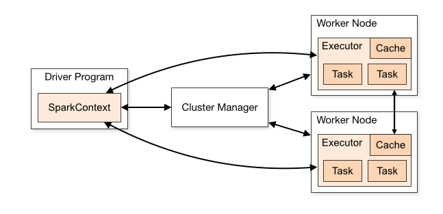
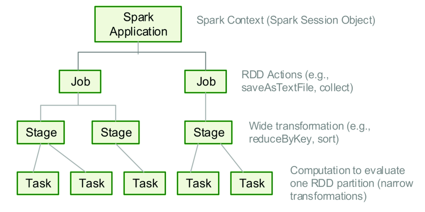

# PySpark
PySpark for -->  Big Data Processing, ETL Pipelines, Real-Time Processing, Machine Learning.......

# ------------------

### Interview Tips:

What is Spark, Architecture, Benefits, Evaluation, Jobs, Stages, Tasks and More..

# -------- What is Apache Spark ----------

What is Spark: Apache Spark is an `open-source`, `distributed data processing engine` used to process and analyze large amounts of data quickly `across multiple CPU cores / computers`.

# -------- Spark Architecture ----------

Program,Node = Computer

# --------- Lazy Evaluation ---------

Lazy Evaluation: is a core design principle in Apache Spark and PySpark where data computations are not executed immediately when defined. Instead, PySpark records the requested operations as a blueprint—a logical plan—and defers execution until a specific result is requested.

# -------- Job & Stage & Task ----------

In PySpark, an execution hierarchy flows from Application → Job → Stage → Task, where each level breaks down the work into smaller, parallel units of execution

# -------- Create Databricks Account ----------

# ------------------

# ------------------

# ------------------

# ------------------

# ------------------

# ------------------

# ------------------

# ------------------

# ------------------

# ------------------

# ------------------

# ------------------

# ------------------

# ------------------

# ------------------

# ------------------

# ------------------

# ------------------

# ------------------

# ------------------

# ------------------

# ------------------

# ------------------

# ------------------

# ------------------

# ------------------

# ------------------

# ------------------

# ------------------

# ------------------

# ------------------